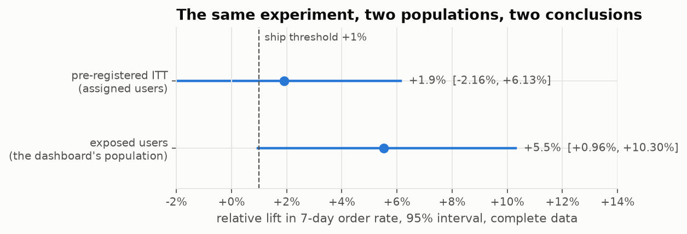
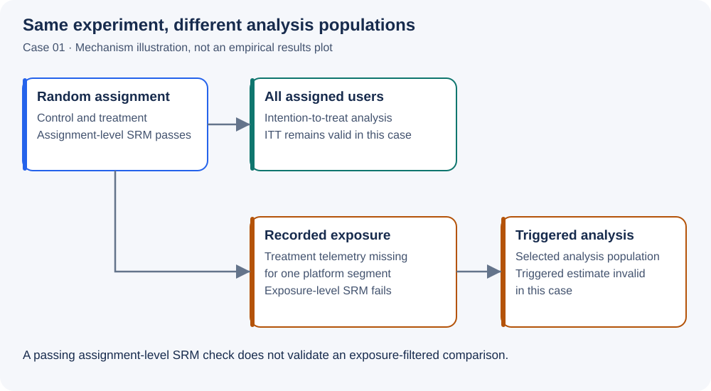
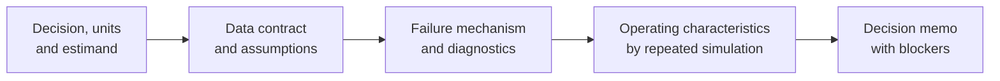

<h1 align="center">ab-test-forensics</h1>

<p align="center"><strong>Experiment Forensics: measuring how A/B tests reach the wrong decision.</strong></p>

<p align="center">
  <a href="https://github.com/AdiMendelowitz/ab-test-forensics/actions/workflows/ci.yml"></a>
  
  
</p>

<p align="center">
  <a href="case_studies/01_lift_we_could_not_trust/README.md">Read the Case 01 investigation</a> ·
  <a href="case_studies/01_lift_we_could_not_trust/decision_memo.md">Read the one-page decision memo</a> ·
  <a href="#quick-start">Run it locally</a>
</p>

<p align="center">
  
</p>
<p align="center"><sub>Case 01, single committed run (seed 20260928), complete data: the same experiment read on two populations.</sub></p>

Reproducible case studies in how online experiments produce the wrong decision, and what a senior practitioner does about it.

Most A/B testing material teaches how to obtain `p < 0.05`. This repository covers the step before that:

> Does the comparison in front of you still have a causal interpretation?

Each case is an incident investigation on simulated or semi-synthetic data with a known ground truth, so every claim about bias, coverage or false-positive rate is measured by repeated simulation. Every result the package returns states its estimand (or that it has none, for a diagnostic), its assumptions and its warnings, and no function returns a ship decision.

## Case 01 at a glance

Measured across 5,000 simulated experiments per scenario; Monte Carlo standard errors in brackets.

| Measure | Dashboard (exposed users, day 14) | Pre-registered ITT (assigned users) |
| :--- | ---: | ---: |
| False-positive rate under a true null, nominal 5% | 10.7% (0.4) | 5.1% (0.3) |
| Coverage of the decision-relevant lift by the 95% interval | 85.8% (0.5) | 94.7% (0.3) |
| Ship-rule rate when the true lift is +3.0% among rendered users (+2.55% ITT) | 33.0% (0.7) | 11.1% (0.4) |

Source: the operating-characteristics section of the [Case 01 investigation](case_studies/01_lift_we_could_not_trust/README.md#operating-characteristics), regenerated by `uv run abf oc case01`.

## Cases

| Case | Question | Status |
| :--- | :--- | :--- |
| 01 | Can you trust a lift after exposure telemetry is lost? | Built; reproduced from a fresh clone on Windows 11 and Linux |
| 02 | What does a ratio metric actually estimate? | Notebook built; README, decision memo and data contract pending |
| 03 | What changes when time is the randomisation unit? | Planned |

### 01 · The lift we could not trust

Exposure telemetry is lost for one platform segment on the treatment side, and the dashboard analyses exposed users. The sample ratio mismatch (SRM) check passes on assignment and fails on exposure; the intention-to-treat (ITT) estimate stays valid while the triggered estimate does not. Operating characteristics at B = 5,000 per scenario.

<p align="center">
  
</p>
<p align="center"><sub>Mechanism illustration, not a results plot: missing exposure records change who appears in the dashboard comparison, not who was assigned.</sub></p>

[Read the investigation](case_studies/01_lift_we_could_not_trust/README.md) · [Read the decision memo](case_studies/01_lift_we_could_not_trust/decision_memo.md)

### 02 · The metric that told two stories

A user-randomised, event-analysed ratio metric with heavy-tailed exposure and a treatment-induced denominator shift. The notebook states three estimands side by side, compares the delta-method, jackknife and bootstrap intervals on the ratio, and measures the naive interval's Type I error. Operating characteristics at B = 2,000 per scenario.

### 03 · When time becomes the treatment unit

Planned: carryover under autocorrelated outcomes in a time-block randomised experiment on real hourly load data, analysed with block-aware methods and a washout, with bias and power measured across block lengths.

Two claims run through the cases: the analysed population must be the randomised one (Case 01), and the variance of an estimate must respect the unit that was randomised, not the unit that was measured (Case 02, and Case 03 once built).

<details>
<summary><strong>Phase 2 roadmap</strong></summary>

- CUPED under covariate drift and leakage
- Continuous peeking and sequential tests
- Metric governance and delayed outcomes
- Time-varying effects: trend testing, novelty and primacy
- Heterogeneity on genuinely randomised data

</details>

## How an investigation works



## What each case contains

| Artefact | Purpose |
| :--- | :--- |
| `README.md` | Decision, unit hierarchy, estimand, evidence, blockers |
| `analysis.ipynb` | The investigation, importing only from the package |
| `decision_memo.md` | One page for the decision owner |
| `data_contract.md` | Tables, keys, units, event definitions |
| `figures/` | The investigation's figures |
| `config.yaml` | Seed, design and incident parameters |

The design specification each case was built against is in `docs/design/`.

## Quick start

Requires git and [uv](https://docs.astral.sh/uv/); uv provides the Python version pinned in `.python-version`.

```bash
git clone https://github.com/AdiMendelowitz/ab-test-forensics.git
cd ab-test-forensics
uv sync --group dev
uv run pytest                 # fast suite, under a minute on a laptop
uv run pytest -m slow         # coverage, bias and seed-rule simulations, about three minutes on two cores
uv run abf simulate case01    # regenerate the case's data from its config and seed
uv run abf run case01         # execute the notebook headless
uv run abf oc case01          # operating characteristics, tables in results/case01/ (runtime in the case README)
```

> [!IMPORTANT]
> A fresh clone runs Case 01 with no download. Case 02 builds its population from the EB-NeRD small dataset, which is not redistributed here: place it under `data/raw/ebnerd_small` (source and licence terms in `docs/design/case-02.md`, section 6) before running `uv run abf simulate case02`.

Python 3.14 is the development version; 3.12 and 3.14 are tested in CI.

## Standards

- Every estimator is validated by repeated simulation, with B stated and the Monte Carlo standard error reported next to every rate; the runner is `abf oc <case>`, and no case is declared complete before its tables exist.
- Every case declares whether its data is simulated, semi-synthetic or genuinely randomised, and why.
- SRM is treated as a diagnostic, and a validity verdict needs more than a passing check.
- Incidents are described as plausible mechanisms.

<details>
<summary><strong>Repository layout</strong></summary>

```text
src/abforensics/    diagnostics, inference, metrics, simulation, reporting, results
tests/unit/         fast, CI
tests/simulation/   slow, run before a case is declared done
case_studies/       one folder per case
docs/design/        design specs, written before code
docs/methodology/   short method notes (SRM so far)
docs/templates/     case README, decision memo, data contract, review checklist
data/manifests/     seed, true effect, parameters and checksums per generated dataset
```

Generated data, raw downloads and the operating-characteristic replicate cache are untracked and rebuilt by the commands above; the operating-characteristic summary tables under `results/` are tracked because the case READMEs cite them.

</details>

## Author and licence

Adi Mendelowitz · [blog](https://blog.adimendelowitz.dev/)

Code: MIT (see `LICENSE`). Case 01 data is simulated. Case 02 uses the EB-NeRD dataset under its general licence terms (research, non-commercial); the raw data is not redistributed, and committed files hold aggregates only (`docs/design/case-02.md`, section 6).
