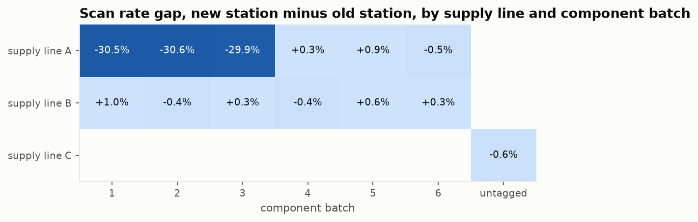
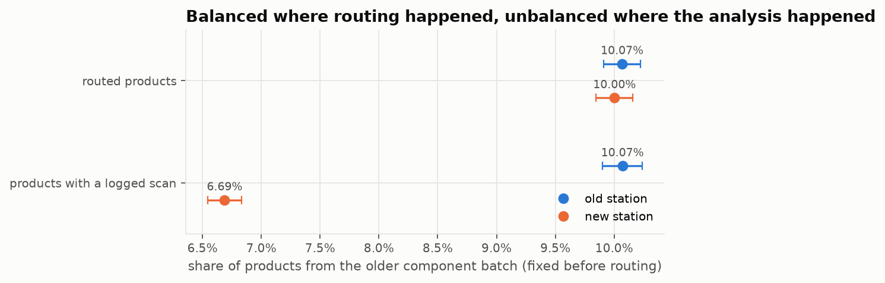
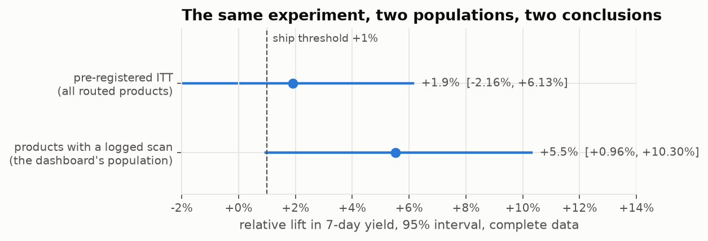
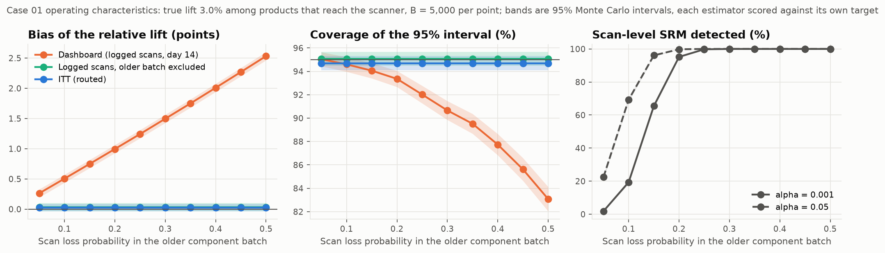

# Case 01: Lost Logs, Found Lift

## Decision and executive summary

Recommendation: do not ship. Stop the experiment, repair the redesigned station's scanner, A/A-validate the scan pipeline, and rerun the experiment under the same pre-declared design with the fix in place.

A redesigned assembly station is on a 50/50 product-randomised test planned for 21 days of intake; this case is the interim look, which reads the 280,000 eligible products taken in during the first 14 days once their outcomes are complete. In the committed run (one simulated experiment, seed 20260928, chosen by a stated rule as the first seed whose run shows this story; a random seed shows it 22.4% of the time), the team dashboard on day 14 showed a +6.4% relative lift in the 7-day yield (95% interval +1.6% to +11.5%, p = 0.009), clearing the ship rule. The dashboard compares products with a logged scan, and the redesigned station's scanner loses that scan for about 35% of the products the new station handles from the older component batch (supply line A, batches 1 to 3), the lowest-yielding batch, so the new-station products with a logged scan are enriched with better-yielding products. The routing-level sample-ratio check passes (chi-square 0.38); the scan-level check fails (chi-square 85.6). The intent-to-treat estimate on the routed population is +1.9% (interval −2.2% to +6.1%, p = 0.36), whose interval falls in the rule's continue zone; the rule itself gives no decision while the scan and cycle-time blockers are open. Across 5,000 simulated replicates of this incident, the day-14 dashboard's interval covers its own target 89.5% of the time (Monte Carlo SE 0.4) and the decision-relevant ITT lift 85.8% (SE 0.5), against 94.7% (SE 0.3) for the intent-to-treat interval; under a true null the dashboard rejects 10.7% of the time (SE 0.4) at a nominal 5%, and reports a significant positive lift 10.2% of the time against 2.6% with no incident (scenario A).

## Units and estimand

| Unit | Definition |
|---|---|
| Randomisation unit | Product, by deterministic hash of product id at first eligibility |
| Eligibility unit | Product arriving at the assembly stage in the experiment window |
| Scan unit | Product for which the assembly station (old in the old-station arm, redesigned in the new-station arm) logged a scan |
| Outcome-observation unit | Product; finished within 7 days of first eligibility |
| Analysis unit | Product |
| Clustering unit | None assumed (one scanner per product; matching one product across scanners is an open risk) |

Primary estimand: intent-to-treat difference in expected 7-day yield among eligible products, E[Y(1) − Y(0)], reported absolute and as a relative lift over the old-station arm.
Secondary estimand (the dashboard's): the same difference among products that reach the scanner. For about 15% of eligible products, in both arms alike, the product takes the legacy manual route and no station handles it; it can still be finished but cannot be affected by the station, so the ITT effect is the effect among products that reach the scanner diluted by them (+2.55% against +3.0%). A triggered analysis of products that reach the scanner is valid when the scan is logged the same way in both arms, and it is then more powerful against zero than ITT (scenario C below). Here the scan is lost differentially, so the population with a logged scan targets neither estimand. Removing the older component batch from both arms, a pre-treatment exclusion, restores a valid triggered comparison for products that reach the scanner outside that batch (about 76% of eligible products); its estimand is the lift among them, on the triggered scale.
Metric: 7-day yield per eligible product, finished products counted when received by the analysis clock.
Estimator: difference in arm-level product proportions, unpooled Wald interval, and a delta-method interval on the log ratio, exponentiated for the relative lift (`difference_in_proportions`).

Timeline: intake runs for 21 days. The interim look reads the products taken in on days 1 to 14 once their outcomes are complete (24 March, 12:00); the final look reads all 21 days of products when theirs are (31 March, 12:00). The final-look decision itself waits for the return guardrail: its last cohort matures on 13 April, 12:00, so the primary metric is read on 31 March and the decision is taken on 13 April. The interim look reads returns on the finished products matured by its clock.

Decision rule (the case treats it as pre-declared; section 16 of the spec records which parts were added or revised during the build), checked in sequence at each look:

1. Stop if any guardrail breaches.
2. No decision while a decision blocker is open (a scan or routing issue, a guardrail that cannot be measured, or, at the final look, a guardrail whose outcome window has not closed); investigate first.
3. Stop if the upper 95% bound on the relative ITT lift is below 0.
4. Ship if the lower bound on the relative ITT lift exceeds +1.0% (95% interval at the interim look, 97.5% at the final look, z = 2.24) and the must-pass guardrails pass.
5. Otherwise, at the interim look: continue to the final look.
6. Otherwise, at the final look: do not ship; the lift is not shown to exceed the +1.0% floor.

Guardrails, each against a non-inferiority margin on the new-station-minus-old-station difference (`config.yaml`): packing-step errors +0.3 points and p95 cycle time +5% relative, both of which must pass; return rate +10% relative, which is breach-only. A guardrail passes when the upper 95% bound is at or below its margin, breaches when the lower 95% bound is above it, and is inconclusive otherwise. At no true effect the packing-step guardrail passes about 95% of the time at this sample size. A +10% return margin would pass a harmless change only about 18% of the time on a complete 14-day cohort (about 4,500 finished products per arm at a 5% return rate), and 80% of the time would need about 33,000 finished products per arm, so the return guardrail can stop a launch but is not required to pass. +10% is the harm tolerance: at the +1.0% ship floor, a return increase above +18.8% would cancel the gain in kept finished products. During the review the return margin was briefly raised to +25% so that a pass was reachable, then restored to +10% as breach-only; this run's return verdict (inconclusive, no breach) is the same under every version.

The final look has a stated cost. With the interim look at z = 1.96 and the final look at z = 2.24 (correlation sqrt(14/21) between the two statistics, treating information as proportional to products taken in), the probability of shipping when the true relative ITT lift is exactly +1.0% is 3.0% over both looks, against 2.5% for a single look and 3.85% if the final look reused z = 1.96. These are asymptotic and upper bounds, since the stop and guardrail conditions only remove ship outcomes. The two-sided analogue is 6.0% (7.7% with 1.96 at both of these unequal looks; Armitage, McPherson and Rowe, 1969, give 8.3% for two equally spaced looks). An O'Brien-Fleming boundary (z = 2.45 at day 14, 2.00 at day 21) would hold 2.5%, at the price of a stricter first look. Monitoring policy is the subject of a Phase 2 case.

Power: at 140,000 products per arm a 6% relative lift has 81% power to reject zero, while the ship rule asks the lower bound to clear +1.0%; against that margin power at a 6% lift is 65.5%, and 80% would need about 197,000 products per arm. The design keeps 140,000 and states the 65.5% (see Operating characteristics; design note section 5, kept outside the repository). The simulated effect is +3.0% among products that reach the scanner and +2.55% intent-to-treat after dilution. At those effects the ITT ship-rule rate at the interim look is 11.1% (Monte Carlo SE 0.4; analytic 11.1%), and even a clean rerun would clear the bar at either look about one time in seven (14%, analytic, on the primary metric alone). Confirming a +2.55% lift against the +1.0% floor with 80% probability would need about 2 million products per arm, roughly seven months of throughput. An inconclusive ITT result is therefore the expected outcome, and it is not evidence against the redesign; the business question it raises is whether a lift of this size is worth confirming with this throughput.

## Data provenance

All data is simulated by `abforensics.simulation.assembly_incident` (`abf simulate case01`). Seed, the true effect (+3.0% among products that reach the scanner; the ITT truth, +2.55%, is `expected_relative_lift_itt`), every incident parameter, row counts and content checksums are in `data/manifests/case01.json`. The case seed was chosen by a stated rule, recorded in `config.yaml` and re-checked by `tests/simulation/test_case_seed.py`: the first seed from 20260928 upwards whose single run shows the case's story (the day-14 dashboard clears the ship rule, the complete-data ITT interval lands in the continue zone, the routing SRM check passes). The rule was written during the generator rework after 20260928 failed it under an intermediate version; under the final generator 20260928, the first candidate, meets it. Across replicates of the incident the story appears 22.4% of the time (MC SE 0.6), so the single run illustrates the mechanism in a run selected to show it, and every rate and bias claim comes from the operating characteristics below. From a fresh clone at commit 8b99cd5, with the locked library versions (NumPy 2.5.3, pandas 3.0.6, SciPy 1.18.1), the three commands under Reproduce regenerated all seven manifest checksums and the five operating-characteristic tables in `results/case01/` byte for byte on Windows 11 (CPython 3.14.0) and on Linux (Ubuntu under WSL2, CPython 3.14.4). On both operating systems the executed notebook printed the same results, and figures 1 to 4 were pixel-identical to the committed ones. `oc_meta.json` records the Linux run. The simulation generates only the cohorts the interim look reads (days 1 to 14). The incident is a plausible scan-log mechanism and is described as such throughout. The notebook never reads the `truth` table, which is written for audit only. See Units and estimand for the design this was built against and `data_contract.md` for the tables.

## Diagnostic evidence

Figures 1 to 3 and the numbers in this section come from the single committed run (seed 20260928).



New-station-minus-old-station scan rate by supply line and component batch. The gap is confined to supply line A, batches 1 to 3, on the new-station side, at 30 to 31 points of those products (35% of the ones that reach the scanner); every other cell is at parity. Both arms also have about 15% of products with no scan, the legacy-route share, equal by arm.



Share of products from the older component batch (supply line A, batches 1 to 3), a pre-treatment attribute, per arm. Balanced on the routed population (10.07% old station, 10.00% new station), unbalanced on the population with a logged scan (10.07% against 6.69%). The pre-period finished-product count on the population with a logged scan shifts in the expected direction without being flagged (p = 0.28 against a 0.001 threshold): the excess lost products are 3.6% of the products the new station handles (3.0% of the arm) and average 0.36 pre-period finished products against 0.59, an expected shift of 0.008 against a standard error of 0.007. Composition invariants catch what outcome-proxy invariants miss at this magnitude.



The scan-based and ITT estimates on complete data against the +1.0% ship threshold (the scan-based estimate is +5.5% at the data-complete date and +6.4% on the day-14 dashboard). In this run the gap between them is 3.6 points. Across all replicates of scenario D the mean gap is 2.18 points: 1.76 points of upward bias in the scan-based estimate against its own target, plus 0.45 points because the two estimators target different lifts (3.0% and 2.55%), less the ITT estimate's own +0.03 (SE 0.03) of Monte Carlo noise. Among the replicates that show the case's story the mean gap is 2.75 points and the mean ITT estimate 3.8% against a 2.55% truth, so the size of this run's gap reflects how the seed was chosen as well as the bias.

## Operating characteristics

`abf oc case01` re-runs the generator with a fresh routing salt on every replicate and applies four estimators: the dashboard as read on day 14, the same population with a logged scan on complete data, the population with a logged scan with the older component batch removed from both arms, and ITT. Each is scored against its own target (the lift among products that reach the scanner for the scan-based estimators, the all-eligible lift for ITT) and against the ITT lift, the decision estimand. B = 5,000 replicates per scenario and per loss-sweep point, 1,000 per yield-deficit point. Every rate carries its Monte Carlo SE, sqrt(r(1 − r)/B), and a Clopper-Pearson 95% interval where a rate is 0% or 100%; every bias carries sd/sqrt(B). From a fresh clone the command took 12 minutes wall-clock on Linux (WSL2) and 18 minutes on Windows 11, on the same laptop. Tables: `results/case01/oc_*.csv`, with run metadata in `oc_meta.json`.

| Scenario | Estimator | True lift | Bias, own target (points of relative lift) | Bias against ITT lift | Coverage, own target | Rejects zero | Ship-rule rate | Scan-level SRM flagged (alpha 0.001) |
|---|---|---|---|---|---|---|---|---|
| A: null, no incident | dashboard, day 14 | +0.00% | +0.03 (0.03) | +0.03 (0.03) | 95.0% (0.3) | 5.0% (0.3) | 0.96% (0.14) | 0.12% (0.05) |
| A: null, no incident | logged scans, complete data | +0.00% | +0.03 (0.03) | +0.03 (0.03) | 94.9% (0.3) | 5.1% (0.3) | 1.1% (0.1) | 0.12% (0.05) |
| A: null, no incident | logged scans, older batch removed | +0.00% | +0.03 (0.03) | +0.03 (0.03) | 94.9% (0.3) | 5.1% (0.3) | 1.0% (0.1) | 0.12% (0.05) |
| A: null, no incident | ITT | +0.00% | +0.03 (0.03) | +0.03 (0.03) | 94.9% (0.3) | 5.1% (0.3) | 0.92% (0.14) | 0.12% (0.05) |
| B: null, incident | dashboard, day 14 | +0.00% | +1.70 (0.03) | +1.70 (0.03) | 89.3% (0.4) | 10.7% (0.4) | 4.5% (0.3) | 100% (CI ≥99.92%) |
| B: null, incident | logged scans, complete data | +0.00% | +1.71 (0.03) | +1.71 (0.03) | 88.5% (0.5) | 11.5% (0.5) | 5.0% (0.3) | 100% (CI ≥99.92%) |
| B: null, incident | logged scans, older batch removed | +0.00% | +0.03 (0.03) | +0.03 (0.03) | 94.9% (0.3) | 5.1% (0.3) | 1.0% (0.1) | 100% (CI ≥99.92%) |
| B: null, incident | ITT | +0.00% | +0.03 (0.03) | +0.03 (0.03) | 94.9% (0.3) | 5.1% (0.3) | 0.92% (0.14) | 100% (CI ≥99.92%) |
| C: effect, no incident | dashboard, day 14 | +3.00% | +0.02 (0.03) | +0.47 (0.03) | 95.2% (0.3) | 23.6% (0.6) | 12.7% (0.5) | 0.12% (0.05) |
| C: effect, no incident | logged scans, complete data | +3.00% | +0.03 (0.03) | +0.48 (0.03) | 95.0% (0.3) | 26.1% (0.6) | 14.0% (0.5) | 0.12% (0.05) |
| C: effect, no incident | logged scans, older batch removed | +3.00% | +0.03 (0.03) | +0.48 (0.03) | 95.1% (0.3) | 24.9% (0.6) | 13.4% (0.5) | 0.12% (0.05) |
| C: effect, no incident | ITT | +2.55% | +0.03 (0.03) | +0.03 (0.03) | 94.7% (0.3) | 23.2% (0.6) | 11.1% (0.4) | 0.12% (0.05) |
| D: effect, incident | dashboard, day 14 | +3.00% | +1.75 (0.03) | +2.20 (0.03) | 89.5% (0.4) | 49.3% (0.7) | 33.0% (0.7) | 100% (CI ≥99.92%) |
| D: effect, incident | logged scans, complete data | +3.00% | +1.76 (0.03) | +2.21 (0.03) | 88.3% (0.5) | 53.4% (0.7) | 36.0% (0.7) | 100% (CI ≥99.92%) |
| D: effect, incident | logged scans, older batch removed | +3.00% | +0.03 (0.03) | +0.48 (0.03) | 95.1% (0.3) | 24.9% (0.6) | 13.4% (0.5) | 100% (CI ≥99.92%) |
| D: effect, incident | ITT | +2.55% | +0.03 (0.03) | +0.03 (0.03) | 94.7% (0.3) | 23.2% (0.6) | 11.1% (0.4) | 100% (CI ≥99.92%) |
| F: effect, loss in both arms | dashboard, day 14 | +3.00% | +0.02 (0.03) | +0.47 (0.03) | 95.3% (0.3) | 23.4% (0.6) | 12.4% (0.5) | 0.10% (0.04) |
| F: effect, loss in both arms | logged scans, complete data | +3.00% | +0.03 (0.03) | +0.48 (0.03) | 94.9% (0.3) | 25.9% (0.6) | 13.7% (0.5) | 0.10% (0.04) |
| F: effect, loss in both arms | logged scans, older batch removed | +3.00% | +0.03 (0.03) | +0.48 (0.03) | 95.1% (0.3) | 24.9% (0.6) | 13.4% (0.5) | 0.10% (0.04) |
| F: effect, loss in both arms | ITT | +2.55% | +0.03 (0.03) | +0.03 (0.03) | 94.7% (0.3) | 23.2% (0.6) | 11.1% (0.4) | 0.10% (0.04) |

Monte Carlo standard errors in brackets. Rows share replicates by design (common random numbers): the batch-excluded and ITT rows are identical within A and B and within C, D and F, because the incident never touches those analyses. Differences between rows are therefore read from paired contrasts, whose Monte Carlo SE is 47% to 81% of the unpaired SE for rates and far smaller for the bias contrast:

| Contrast | Difference | Paired MC SE |
|---|---|---|
| C: scan-based minus ITT, rejects zero (26.1% against 23.2%) | +2.9 percentage points | 0.4 |
| C: scan-based minus ITT, ship rule (14.0% against 11.1%) | +2.9 percentage points | 0.4 |
| C: scan-based (bound rescaled to the ITT lift) minus ITT, ship rule (12.3% against 11.1%) | +1.2 percentage points | 0.4 |
| B minus A: dashboard rejects zero (10.7% against 5.0%) | +5.7 percentage points | 0.4 |
| D minus C: dashboard ship rule (33.0% against 12.7%) | +20.3 percentage points | 0.6 |
| D minus C: dashboard coverage (89.5% against 95.2%) | −5.7 percentage points | 0.4 |
| D: dashboard day 14 minus scan-based complete, ship rule (33.0% against 36.0%) | −3.1 percentage points | 0.4 |
| D: batch-excluded minus ITT, rejects zero (24.9% against 23.2%) | +1.7 percentage points | 0.5 |
| F minus C: scan-based bias (+0.028 against +0.030 points of relative lift) | −0.002 points | 0.005 |

The routing-level SRM check flags 4.7% of replicates at alpha = 0.05 (SE 0.3), consistent with its nominal rate, and 0.06% at alpha = 0.001 (Clopper-Pearson interval 0.01% to 0.18%).

Scenario C measures the claim that triggered analysis is legitimate and more powerful: with logging intact the scan-based estimator is unbiased for its own target and rejects zero 2.9 points more often than ITT (paired SE 0.4). Its ship-rule rate exceeds ITT's by 2.9 points (paired SE 0.4), and part of that is a change of scale: the +1.0% margin is defined on the ITT lift, and the triggered lift is larger by the dilution factor. With the triggered lower bound rescaled to the ITT lift (multiplied by the replicate's true dilution factor, 0.850; an estimate from the old-station arm would differ by about 0.5% relative) the excess is 1.2 points (paired SE 0.4), the part that is power; the remaining 1.7 points come from applying an ITT margin to a triggered estimate.

In scenario D, the incident, the dashboard's ship-rule rate rises by 20.3 points over C (paired SE 0.6), all of it caused by the incident, because C and D analyse the same simulated experiments and differ only in which scans are logged. Read on day 14 the dashboard ships 3.1 points less often than the same comparison on complete data (paired SE 0.4). Removing the older component batch from both arms removes the bias: that estimator is unbiased for its own target in D (bias +0.03 points, SE 0.03) and rejects zero 1.7 points more often than ITT (paired SE 0.5). The story the committed run shows (day-14 dashboard ships, ITT continues, routing SRM passes) occurs in 22.4% of scenario-D replicates (SE 0.6); given that the dashboard ships, ITT lands in the continue zone 67.9% of the time.

Scenario F loses scans in both arms at the same rate: the scan-level SRM check flags 4.3% of replicates at alpha = 0.05 (SE 0.3), close to its nominal 5%, and the scan-based estimate's bias differs from C's by −0.002 points (paired SE 0.005). With a constant relative effect the estimate stays valid for the products whose scans survive, and the check has nothing to detect.



Sweeping the loss probability from 0.05 to 0.50 (true lift 3%, B = 5,000 per point): the day-14 dashboard's bias against its own target grows linearly, from +0.26 to +2.53 points (MC SE 0.04 or less), and its coverage falls from 95.0% (SE 0.3) to 83.1% (SE 0.5); the batch-excluded estimator stays unbiased throughout. The scan-level SRM check at alpha = 0.001 flags a 5% loss in 1.8% of replicates (SE 0.2), a 10% loss in 19.4% (SE 0.6) and a 15% loss in 65.5% (SE 0.7); it catches almost every run from a 20% loss (95.2%, SE 0.3). A 10% loss, which the check misses 80.6% of the time, still moves the dashboard by 0.50 points against its own target and 0.95 points against the ITT lift. Sweeping the older component batch's yield deficit (`older_batch_logit_offset`, −0.6 to 0, B = 1,000 per point) moves the dashboard's bias from +2.36 to +1.19 points (MC SE 0.08 or less): even with no logit deficit the batch yields less (supply line A's own offset and fewer pre-period finished products), so the bias persists at a zero offset.

## Result and recommendation

Single run, seed 20260928 (the committed data, selected by the rule above); rates across replicates are in the operating-characteristics section.

| Population and clock | Relative lift | 95% interval | p | Zone of the interval against the +1.0% floor (ignoring blockers) |
|---|---|---|---|---|
| Logged scans, dashboard on day 14 | +6.4% | +1.6% to +11.5% | 0.009 | ship |
| Logged scans, complete data | +5.5% | +0.96% to +10.3% | 0.017 | continue |
| Logged scans, older component batch removed from both arms, complete data | +3.8% | −0.7% to +8.6% | 0.10 | not comparable (triggered scale) |
| Routed (pre-registered ITT), complete data | +1.9% | −2.2% to +6.1% | 0.36 | continue |

Under the sequenced rule the outcome of this interim look is no decision: the scan and cycle-time blockers (rule 2) come before any reading of the estimate.

Guardrails, against the pre-declared margins:

- Packing-step errors, per routed product (the randomisation unit): 5.12% of new-station products and 5.16% of old-station products had a packing-step run that raised an error (difference −0.03 points, interval −0.20 to +0.13, p = 0.70); the upper bound is below the +0.3-point margin, so the guardrail passes. Runs per product are equal by arm (1.30).
- Cycle time: the p95 ratio on measured runs is +0.3% (interval −0.2% to +0.8%) overall and +0.1% (−1.6% to +1.8%) within the older component batch (product-clustered bootstrap, 2,000 resamples), both inside the +5% margin. The older component batch is 6.6% of measured new-station runs against 10.1% of old-station runs; its p95 is within about 1% of the rest, so the different mix does not move the overall ratio here. The timing event rides on the scan, so it is missing for 45% of older-batch new-station runs against 15% elsewhere. In this simulation the loss is random within the older batch, so the measured runs represent it; the incident described (products moving off the station within the first second) would tie the loss to behaviour, and until the mechanism is verified the older-batch cycle time stays a blocker.
- Returns: a return can land up to 14 days after the finished product, so at the data-complete date (24 March) the window is open for 45% of finished products and counting returns seen so far gives 4.63%, an understatement. On the matured finished products the rates are 5.04% in the new-station arm and 4.98% in the old-station arm (relative +1.4%, interval −20.5% to +29.3%, p = 0.91). The lower bound is below the +10% margin, so there is no breach so far; the interval also spans the margin, which is why this guardrail is breach-only. For the interim cohorts it is complete by design on 6 April 2026, 12 and a half days after the rest of their data (this run's last finished product matures on 4 April), and the matured finished products come only from products taken in during the first 8.4 days. For the final look's cohorts the date is 13 April. The slowest guardrail sets the date of a complete decision.

Recommendation: do not ship. Stop the experiment, whose remaining intake carries the same defect; fix the scanner on the older component batch (supply line A, batches 1 to 3), run an A/A test of the scan pipeline to confirm parity, and rerun the experiment with the fix in place under the same pre-declared design. The ITT estimate from this run is valid and inconclusive. It is not pooled with the rerun: a restart after the fix does not form the contiguous final look the boundary assumes, and the cycle-time guardrail for these cohorts cannot be recovered. The batch-excluded estimate is valid for products that reach the scanner outside the older component batch and does not answer the decision about all products. Before rerunning, the production lead should accept that a lift of the simulated size would clear the bar only about one time in seven. Evidence that would change the decision: scan parity across arms after the fix, a lower ITT bound above +1.0% at the interim (95%) or final (97.5%) look, cycle time within its margin with a verified logging mechanism, and no return breach on the complete cohort.

## Decision blockers

- [ ] Routing issue unresolved: none, routing-level counts and invariants pass
- [x] Scan measurement issue unresolved: new-station scan lost for the older component batch (supply line A, batches 1 to 3)
- [ ] Outcome logging issue unresolved: records delay is non-differential; handled by using the completion clock
- [x] Missingness may be differential: on scans only
- [x] Guardrail unmeasurable or not yet mature: cycle time missing for 45% of older-batch new-station runs under an unverified loss mechanism; returns read on the matured cohort only until 6 April (13 April for the final look)
- [ ] Duration insufficient for delayed outcomes: none once the completion clock is used

## Assumptions and unresolved risks

The size of the dashboard's bias follows from data-generating constants, none of them sourced from a real production line: the older component batch yields at about half the rate of the rest (1.74% against 3.34% in the old-station arm of this run; logit offsets −0.30 for supply line A and −0.30 for batches 1 to 3, plus fewer pre-period finished products), it is about 10% of products, it loses 35% of the new-station scans, and 15% of products never reach the scanner. The two sweeps above show how the bias moves with the loss probability and the yield deficit. The loss is random within the older component batch; a loss that selected on behaviour (fast movers that yield less or more) would change the bias and is the cheapest assumption for a reviewer to challenge. The plant sees products reaching the scanner only as aggregate counts per supply line, batch and day, so a product-level re-triggering on those counts is unavailable. One scanner per product; no interference between products; the central records of finished products are intact (the incident is scanner-side only); hash-based routing is uniform; the 7-day window captures the effect; the new-station effect is a constant relative lift among products that reach the scanner and zero for the rest. No covariate adjustment is used, although pre-period finished products predict yield; variance reduction (CUPED) is a Phase 2 case. Open risks outside this model: cross-scanner identity, asymmetric filtering of test scans, novelty effects. The return comparison conditions on having been finished, a post-treatment event, which is harmless here only because the simulated effect on returns is zero.

## Reproduce

```
uv run abf simulate case01
uv run abf run case01
uv run abf oc case01
```

`abf oc` caches each unit of work under `results/case01/parts/`, keyed by a hash of its inputs, the library versions and the source of the simulation and estimation modules, and resumes if interrupted; `--max-seconds` splits a long run between units.

## Names in the code and data

The code and data keep the generator's original identifiers; this key maps them to the story used here and in the blog post.

| Term in this story | Identifier in the code and data |
|---|---|
| product | `product_id`, `products` table |
| old station / new station | `arm` = `control` / `treatment` |
| supply line A / B / C | `supply_line` = `A` / `B` / `C` |
| batch 1 to 6, untagged | `batch` = `1` to `6`, `untagged` |
| scan | `scans` table |
| reached the scanner | `truth.reached_scanner` |
| scan logged | `truth.scan_logged` |
| finished product | `finished_products` table |
| packing step | `packing_runs` table |
| the generator | `abforensics.simulation.assembly_incident` |
