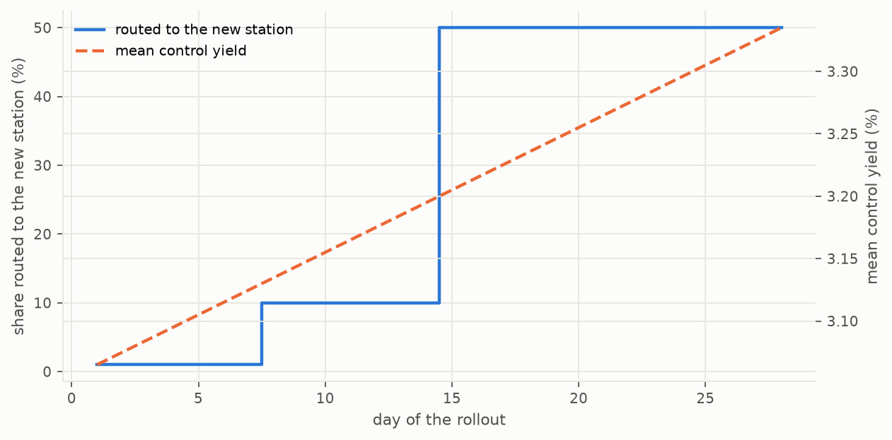
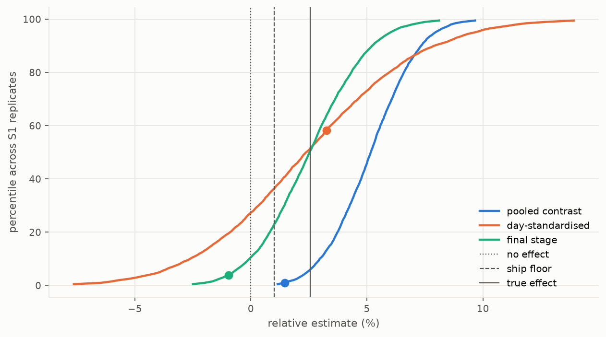
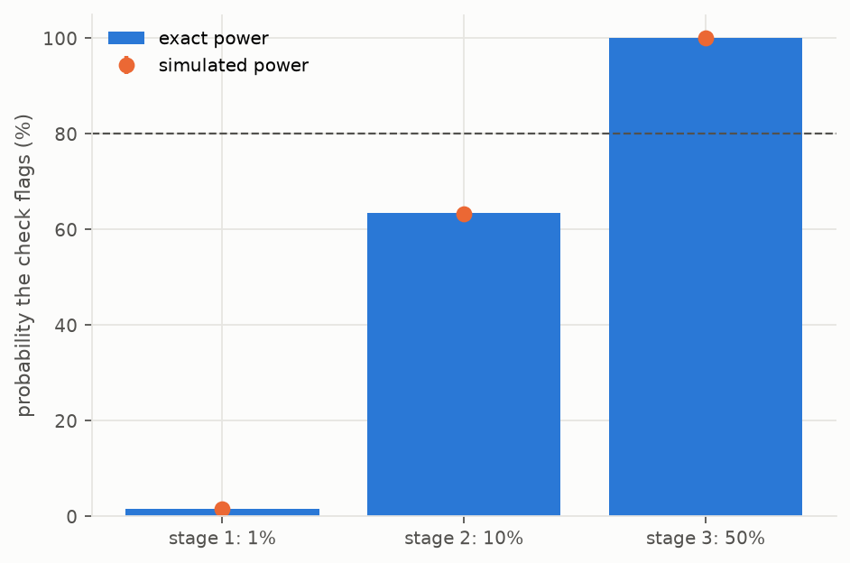

# Case 01, part III: reading a staged rollout

[Read the part III blog post](https://blog.adimendelowitz.dev/ab-test-forensics/lost-logs-found-lift-part-3.html) · [The arithmetic behind the ramp](https://blog.adimendelowitz.dev/ab-test-forensics/arithmetic-behind-the-ramp.html) · [Back to the Case 01 investigation](../README.md)

Everything here is simulated. The repaired new station from the [Case 01 investigation](../README.md) is re-released through a staged rollout. The share of products routed to it rises in three stages, and over the same weeks the baseline yield drifts upwards. The case asks two questions: which reads of the ramp are valid, and whether the ramp's own sample-ratio check would see the Case 01 scan-logging defect again.

## Decision and executive summary

The case recommends reading a staged rollout with the day-standardised contrast for the whole ramp, or with the final stage alone for the effect at the last allocation.

- Pooling every day of the ramp misreads the whole-ramp effect. New-station products arrive mostly late, when the baseline yield is higher. With no true effect and the default drift, the pooled relative contrast averages +2.62% across the simulated rollouts, and its test rejects a true null in 35.3% of them.
- Two reads stay valid, each for its own estimand. The day-standardised contrast reads the effect over the whole ramp, and the final stage alone reads the effect at the last allocation. With no true effect their tests reject in 5.4% and 5.0% of rollouts.
- The drift drives the pooled read's ship decisions. With a true relative effect of 2.55%, the pooled lower bound clears the +1.0% ship floor in 70.0% of rollouts, against 5.8% for the day-standardised contrast and 10.8% for the final stage.
- The ramp's check is weak where the ramp starts. Run once at the end of each stage against the Case 01 defect, it flags with exact probability 1.61% at the first stage and 63.46% at the second. A quiet check at the first stage is no evidence that the defect is gone.

## The design

| Stage | First day | Last day | Share routed to the new station | Products in the stage |
|---|---|---|---|---|
| 1 | 1 | 7 | 1% | 140,000 |
| 2 | 8 | 14 | 10% | 140,000 |
| 3 | 15 | 28 | 50% | 280,000 |

Each product is assigned on its arrival day, with the probability of that day's stage, and the remainder of the day's products go to the old station. The effect, the legacy route, the drift and the defect are set in [`config.yaml`](config.yaml), whose shared values equal the Case 01 configuration. The drift is set by `trend_kappa`, written κ in the tables below, and the mean control yield on day d is the baseline multiplied by `1 + trend_kappa * (d - 14.5)`. The true relative effect among all products is 2.55% on every day.

<p align="center">
  
</p>

## Estimands and estimators

| Estimator | What it compares | Estimand | Reads its estimand? |
|---|---|---|---|
| pooled contrast | every new-station product against every old-station product | E_ramp, the effect over every product of the ramp | no |
| day-standardised | each day's contrast, weighted by that day's products | E_ramp | yes |
| final stage | the Case 01 intention-to-treat estimator on the last stage only | E_final, the effect over products of the last stage | yes |

## Operating characteristics

Scenarios S0 to S2 run 5,000 rollouts each, and the canary runs 10,000 per stage. S0 has no effect, S1 has the effect on every day, and S2 grows the effect across the stages, so that E_ramp and E_final differ. A rate's Monte Carlo standard error is about 0.3 points near 95% coverage and is listed for every row in [`oc_rollout_scenarios.csv`](../../../results/case01/rollout/oc_rollout_scenarios.csv). The committed run of the operating characteristics raises no flag.

| Scenario | Drift κ | Estimator | Truth (relative) | Mean estimate (relative) | Coverage | Rejects zero | Lower bound above +1.0% |
|---|---|---|---|---|---|---|---|
| S0 | 0.003125 | pooled contrast | 0 | +2.62% | 64.7% | 35.3% | 16.1% |
| S0 | 0.003125 | day-standardised | 0 | +0.08% | 94.6% | 5.4% | 1.1% |
| S0 | 0.003125 | final stage | 0 | +0.06% | 95.0% | 5.0% | 0.8% |
| S1 | 0.003125 | pooled contrast | 2.55% | +5.17% | 65.6% | 87.1% | 70.0% |
| S1 | 0.003125 | day-standardised | 2.55% | +2.54% | 94.2% | 9.9% | 5.8% |
| S1 | 0.003125 | final stage | 2.55% | +2.56% | 95.4% | 23.3% | 10.8% |
| S2 | 0.003125 | pooled contrast | 1.62% | +5.07% | 46.0% | 85.8% | 68.4% |
| S2 | 0.003125 | day-standardised | 1.62% | +1.62% | 94.6% | 7.1% | 3.0% |
| S2 | 0.003125 | final stage | 2.55% | +2.58% | 94.9% | 24.3% | 11.6% |

The pooled contrast's error grows with the drift. With no effect it averages −0.01%, +1.32%, +2.62% and +5.16% at the four drift values of the sweep (κ of 0, 0.0015625, 0.003125 and 0.00625), and its test rejects in 5.0%, 11.7%, 35.3% and 86.9% of rollouts. In S1 the pooled and day-standardised estimates disagree in sign in 27.3% of rollouts (Monte Carlo standard error 0.6 points).

The day-standardised contrast reads its estimand and is imprecise. The first stage carries 84.1% of its variance, because it holds few new-station products on each day, and in S2 its test rejects zero in only 7.1% of rollouts, which leaves the whole-ramp read little power at this effect size.

<p align="center">
  
</p>

## The canary

The ramp's scan-level sample-ratio check runs once at the end of each stage, at `alpha = 0.001` per look, against the Case 01 defect (scans lost for one component batch on the new-station side).

| Stage | Share routed to the new station | Products in the stage | Exact power | Simulated power | Monte Carlo SE |
|---|---|---|---|---|---|
| 1 | 1% | 140,000 | 1.61% | 1.62% | 0.13 points |
| 2 | 10% | 140,000 | 63.46% | 63.24% | 0.48 points |
| 3 | 50% | 280,000 | 100.00% | 100% | 0 points |

Stage 3's exact power is 0.999999949, shown as 100.00%. These powers hold only for this defect size and one look at the end of each stage.

<p align="center">
  
</p>

## The committed run

The committed run is one product-level rollout, run once and not selected for what it shows. It illustrates the three estimators on a single draw, and the rates above come from the scenarios.

| Estimator | Estimand | Estimate (relative) | Interval low | Interval high | Ships |
|---|---|---|---|---|---|
| pooled contrast | E_ramp | +1.45% | −1.73% | +4.74% | no |
| day-standardised | E_ramp | +3.26% | −4.59% | +11.77% | no |
| final stage | E_final | −0.97% | −4.87% | +3.09% | no |

All three 95% intervals cover the true 2.55%. The check raised no flag at any stage of this run.

## Assumptions and limits

- The drift is an illustration. Its default value makes the pooled error at no effect about as large as the true effect. It is not a claim about real drifts.
- The day-standardised Wald interval's Type I error is 4.98% to 5.44% across the drift sweep, consistent with the nominal 5% at the Monte Carlo error above. The figures are reported as measured, with no correction.
- The canary results describe one defect size and one look per stage.

## Reproduce

```
uv run abf simulate case01-rollout
uv run abf run case01-rollout
uv run abf oc case01-rollout
uv run python scripts/build_case01_rollout_notebook.py
uv run jupyter nbconvert --to notebook --execute --inplace case_studies/01_lost_logs_found_lift/rollout/analysis.ipynb
```

`abf run` and `abf oc` write the tables in [`results/case01/rollout/`](../../../results/case01/rollout/). The notebook reads only those tables and [`config.yaml`](config.yaml), prints every number above and draws figures T1 to T3. It is generated: `scripts/build_case01_rollout_notebook.py` writes it, and `tests/unit/test_build_case01_rollout_notebook.py` fails if the cell sources of the committed notebook differ from what the builder writes.
