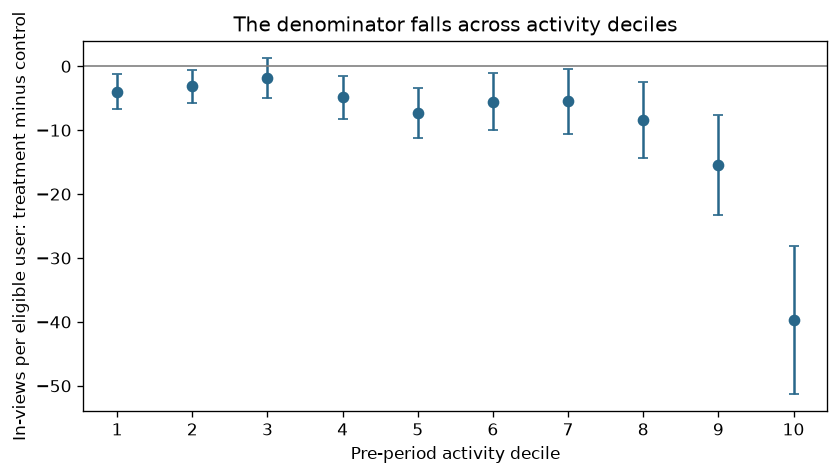
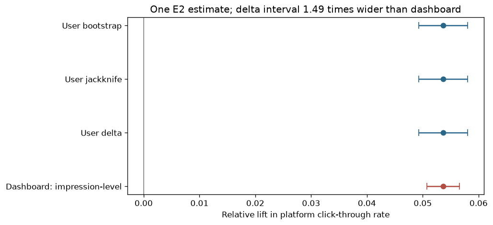
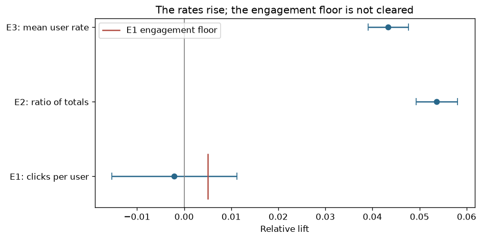
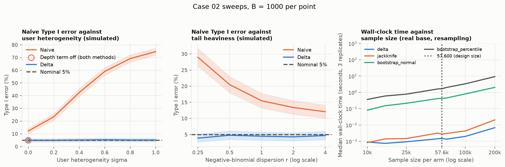

# Case 02: The metric that told two stories

## Decision and executive summary

The committed draw does not meet the engagement success criterion (row 5 of the decision rule), so the rule's output is: do not ship the ranking change as an engagement gain. Treat it as an efficiency change and decide it on its own rule, and keep the dashboard's interval out of the decision. The committed draw is a selected illustrative draw: seed 20261002, the first seed at or above that start whose run shows the story, which a random seed shows in 0.961 of 2,000 harness replicates (MC SE 0.0043).

In this simulated experiment, a feed-ranking change appears on the team's dashboard to raise click-through rate by about 5% with p far below 0.001 (committed run: +5.37%, naive 95% interval +5.07% to +5.66%).
The dashboard divides all clicks by all impressions and treats every impression as an independent trial, although sampled user draws were randomised and a draw's impressions share that user's click propensity.
On the committed draw the user-level interval is 1.49 times as wide as the dashboard's interval, and across 400 A/A splits of the real users the naive test rejects a true null at nominal 5% in 16.8% of splits (MC SE 1.9 points) against 4.5% for the delta method (MC SE 1.0 point).
Correcting the interval leaves the decision unchanged, because the rule reads clicks per eligible user, and that quantity moved by −0.21% (95% interval −1.53% to +1.12%), which lands in row 5 of the pre-declared rule: the engagement gain is not shown to exceed the +0.5% floor.
The ranking change removes in-views that carried few clicks, so in-views per user fall by 5.29% and the ratio rises. In the simulation's ground truth, the removal alone costs 2.44% of clicks per user and the +2.5% lift in click probability offsets that loss (−0.001% combined); on the committed draw, clicks per user were not shown to rise.
The negative-feedback guardrail, which is simulated, passes at its +5% margin (−9.82%, 95% interval −11.79% to −7.81%) and at the +3% re-read.

Two-minute version, in the fictional experiment's own terms: "Users were randomised and impressions were counted. The user-level interval was about 1.5 times as wide as the dashboard interval, and the correction did not change the decision: clicks per user were not shown to rise, while the rate rose as impressions per user fell."
The ratio of 1.5 rests on three measurements that differ slightly. The delta-to-naive standard-error ratio is 1.48 across 400 A/A splits of the base population, it is 1.49 on the committed draw, and scenario A's naive Type I error of 16.5% at 57,600 per arm (MC SE 0.8 points) implies an effective factor of 1.41 (1.36 to 1.47 over the Monte Carlo interval). Inverting a rejection rate through the normal quantile gives a smaller ratio than the measured 1.48 in both cases. The base's 16.8% (Monte Carlo SE 1.9 points) implies 1.42, with a Clopper-Pearson interval of 1.30 to 1.56 that contains 1.48. Scenario A's 16.5% implies 1.41, with an interval of 1.36 to 1.47 that lies below 1.48: with a standard-normal delta statistic, a ratio of 1.48 would give a naive Type I error of 18.5%, above scenario A's Clopper-Pearson 95% interval of 14.9% to 18.2%. Scenario A decomposes the gap. Its naive and delta-method tests share one point estimate, so the naive statistic is the delta statistic multiplied by the ratio of their standard errors, and that ratio is nearly constant (median 1.47, 1st to 99th percentile 1.45 to 1.49). If the delta statistic were standard normal, the median ratio of 1.472 would give a naive rejection rate of 18.3%. Applying the median ratio to the 2,000 simulated delta statistics gives 16.3% instead, and each replicate's own ratio gives the measured 16.5% by construction. The delta statistic's standard deviation across replicates is 0.97 (Monte Carlo SE 0.015, about 1.8 SEs below 1): marginal evidence at 2,000 replicates of a departure from the standard-normal reference, whose source this simulation does not identify. The headline of 1.5 rests on the measured ratios of 1.48 (standard errors over 400 real-user A/A splits) and 1.49 (interval widths on the committed draw).

The case teaches that a ratio metric has two moving parts, and that when the treatment moves the denominator the ratio can rise while the quantity the decision is about stays put. Its second lesson, shared with later cases, is that the variance of an estimate must be computed at the unit that was randomised.

This incident is simulated on real reading behaviour: baseline outcomes are drawn with replacement from the empirical distribution of 15,143 active EB-NeRD readers' observed aggregates, and the treatment potential outcomes, the ranking change, its effect, the dashboard and the negative-feedback guardrail are simulated.

## Units and estimand

| Unit | Definition |
|---|---|
| Randomisation unit | In the incident being simulated: user, by deterministic hash of user id at first eligibility. In the harness: the draw. Each arm is a set of independent draws with replacement from the 15,143-user base, the treatment arm size is Binomial(115,200, 0.5) and the control arm takes the remaining draws, so a population user may appear in both arms |
| Eligibility unit | User with at least one logged page view in the week (EB-NeRD logs a page view only when an article is opened) |
| Exposure unit | Impression: an in-view article, one item rendered in the viewport for at least one second. This is finer than the randomisation unit, which is the point of the case |
| Outcome-observation unit | Impression (click or no click) and user (clicks from first eligibility to the end of the split week) |
| Analysis unit | Draw, declared. The dashboard's analysis unit is the impression, undeclared |
| Clustering unit | Draw: every impression belongs to exactly one draw, and a draw's impressions share that user's propensity |

Three estimands are stated side by side. Each is a legitimate population quantity, and each answers a different question.

- E1, the decision estimand: clicks per eligible user, E[C(1)] − E[C(0)], reported as an absolute difference and a relative lift, with a Welch interval and a delta-method interval on the log ratio. Control level 15.43 clicks per user in the committed draw.
- E2, the dashboard's estimand: platform-level click-through rate, the ratio of expected click totals to expected impression totals, an impression-weighted rate. Control level 0.0904. It answers questions about ad load or impression efficiency. Valid estimator: ratio of arm sums with a user-level delta-method variance (Deng, Knoblich and Lu 2018), cross-checked by a user bootstrap and a delete-one-user jackknife, each taken over draws, where a draw is one resampled user. The pooled two-proportion z-test with n equal to the number of impressions is kept in the package as `naive_event_rate` so that the case can show it.
- E3: mean user-level click rate among users with at least one impression. Control level 0.1012. Each user weighs the same, so light users dominate. It conditions on having an impression, and in this design the treatment never removes a user's last impression, so the conditioning set is the same in both arms by construction; this is a simplification.

Metric for the decision: clicks per eligible user, over the user's clicks from first eligibility to the end of the split week.
Estimator: difference in user means with a Welch interval; delta-method interval on the log ratio for the relative lift.
Decision rule (fixed before the illustrative draw was selected), rows checked in order:

| Order | Condition | Action |
|---|---|---|
| 1 | The negative-feedback guardrail breaches | Do not ship |
| 2 | Any open decision blocker, or the must-pass guardrail inconclusive | No decision; investigate first |
| 3 | Upper bound of the 95% interval on relative lift in clicks per eligible user below 0 | Do not ship: engagement loss |
| 4 | Lower bound above +0.5% and the guardrail passes | Ship |
| 5 | Otherwise | Do not ship: the engagement gain is not shown to exceed the +0.5% floor |

The +0.5% threshold is the practical significance floor: the minimum relative engagement lift that justifies the serving cost of the new ranking model. It is a product input from the product lead. The rule is written on clicks per eligible user because the case's question is engagement. The guardrail is negative-feedback actions per eligible user, margin +5% relative, must pass: it passes when the upper 95% bound is at or below the margin, breaches when the lower bound is above it and is inconclusive otherwise. Every bound the rule reads is an end of the two-sided 95% interval, which makes each one-sided row a test at the 2.5% level and conservative by construction. The +0.5% floor is a stated input of the fictional setting, a product lead's threshold, and not a break-even derived from serving costs.

The case reports the question each estimand answers and does not rank them.

## Data provenance

Baseline outcomes are observed EB-NeRD aggregates resampled with replacement, and the treatment potential outcomes are simulated on the same users' rows. The base population is the EB-NeRD small variant (Ekstra Bladet News Recommendation Dataset, `train` split, 18 to 25 May 2023): 15,143 users, 2,585,747 in-views and 233,763 clicks. Each user's observed 7-day rows are the control arm. The ranking change is simulated on the same users' rows by two parameters: suppression δ = 0.15 removes each of a user's old-tier in-views independently, never the user's last in-view, and a removed in-view takes its click with it; click lift τ = 0.025 turns each retained unclicked in-view into a click with a probability that scales the user's observed click rate by (1 + τ). The committed run uses both (scenario D), and its manifest is `data/manifests/case02.json`. The raw-file md5 of each parquet file is recorded there so a reader can confirm identical bytes.

Active-user selection. EB-NeRD retained only active users, those with 5 to 1,000 clicks over 18 May to 8 June 2023 and at least 5 in-view articles (Kruse et al. 2024, section 2.3.1). The population is therefore active readers selected on activity in and after the split week, and every coverage and Type I error claim in this case is conditional on that selected empirical distribution. Every logged user has at least one click in the 7 days (zero-click share 0.000), so E1 is clicks per reading user.

Draws with replacement. Each replicate of the harness, and the committed run, draws 115,200 users in total with replacement from the 15,143-user base, which is 3.80 draws per population user per arm on average. The estimators then see an independent sample from the empirical distribution of those users, and coverage is measured against the finite population's own truth. This licenses statements about the behaviour of the estimators on this population. Statements about users outside it fall outside what the design supports, and sample sizes above 15,143 per arm sit in that resampling world, which every figure quoted at such a size says.

Old-article tier. The old tier is the oldest tercile of the split's in-views by article age at impression (cut at 9.2 hours). EB-NeRD's article totals cover only each article's first 7 days and overlap the split on 84.5% of in-views, so a totals-based tier would be built partly from the split's own clicks. The mechanism check measured the old tier's share of in-views rising from 0.167 in the lightest activity decile to 0.385 in the heaviest, and the old tier clicks at 0.0444, which is 0.49 of E2. The validation of article age against article click rate is uninformative under the pre-set rule (per-article Spearman −0.126 on 1,218 articles, one age tercile covered), and structurally so, because every article in the leakage-free subset is more than 168 hours old at impression against an old-tier cut of 9.2 hours. The −0.126 is not reported as weak support. The tier rests on the mechanism and on the contrast scenario below, which rebuilds the tier from the split-contaminated totals and moves the E1 truth from −0.001% to −1.29%.

Negative-feedback guardrail. EB-NeRD carries no "hide" or "not interested" action, so the guardrail is simulated in both arms (0.5% per in-view outside the old tier, three times that on old-tier in-views, with a Gamma(2, mean 1) multiplier per population user) and every guardrail figure is labelled simulated. At no true effect the guardrail verdict (Welch interval on negative-feedback actions per user) is pass at the +5% margin in 0.992 of 2,000 replicates (MC SE 0.0020) and at the +3% re-read margin in 0.7525 (MC SE 0.0096), at 57,600 per arm. A guardrail left unpowered for its margin is what a team stalls on or reads as a pass (Schultzberg, Ankargren and Frånberg 2024).

Licence. The EB-NeRD general licence terms grant a research, non-commercial licence (clauses 1.1 and 4.2), allow publishing results to the extent they contain no exact parts of the dataset (4.2), forbid copying beyond the download (4.3), limit use to obtaining results from recommender systems (4.6) and forbid Ekstra Bladet marks in publications (4.8). The repository therefore commits aggregates only: the manifest, the operating-characteristic tables and the figures. Per-user frames are regenerated locally by `abf simulate case02` from the reader's own download, and `abf simulate case02 --synthetic` runs the case without the download on a calibrated parametric generator. This is a reading of the terms and not legal advice.

Order of decisions. The decision rule and its +0.5% floor were fixed first. The sample size was then re-sized from 64,100 to 57,600 per arm after the operating-characteristic check of scenario C, the suppression strength δ = 0.15 was kept for its row-5 rate, and the display seed was searched last.

Seed and the story. The committed run is a single simulated experiment. Its seed, 20261002, is the first seed at or above that start whose run shows the story: the naive and delta-method tests both reject on E2, E1 lands in row 5 of the rule, the guardrail verdict is pass and the assignment sample-ratio check raises no flag at alpha 0.001. The seed search found the story in 0.975 of 200 seeds (MC SE 1.1 points), and the harness's scenario D finds E1 in row 5 in 0.962 of 2,000 replicates (MC SE 0.0043; story rate 0.961, MC SE 0.0043). Choosing the seed selects among noise draws; the truths are fixed before any draw. The suppression strength (δ = 0.15) was kept because it gives that row-5 rate, so scenario D is story-calibrated: it measures how reliably the chosen story appears in this harness and says nothing about how often such a story occurs in real experiments.

## Diagnostic evidence

Assignment and invariant checks raise no flag at alpha 0.001: control 57,381 and treatment 57,819 draws against 57,600 expected (chi-square 1.67, p = 0.197), and subscriber share, device mix and pre-period 21-day clicks per user show no flag. The 19.1 million impressions and 1.78 million clicks of the committed run are the inputs to everything below.



Figure 1 shows where the denominator moved: in-views per user fall by 5.29% overall (95% interval −6.60% to −3.97%), with the largest absolute gap in the heaviest activity decile (−39.7 in-views per user, interval −51.3 to −28.2).



Figure 2 puts the E2 lift of +5.37% under four intervals. The delta-method, user-bootstrap and jackknife intervals agree (delta +4.93% to +5.81%) and are 1.49 times as wide as the dashboard's interval (+5.07% to +5.66%). The delta method and the jackknife agree because both are first-order linearisations of the same ratio, so their agreement checks the implementation and is not an independent method.



Figure 3 sets the three estimands against the rule, with the +0.5% floor drawn on E1 only.

| Estimand | Truth in scenario D | Selected illustrative draw, 95% interval |
|---|---|---|
| E2, click-through rate | +5.23% | +5.37% (+4.93% to +5.81%) |
| E3, mean user-level rate | +4.64% | +4.33% (+3.91% to +4.76%) |
| E1, clicks per user | −0.001% | −0.21% (−1.53% to +1.12%) |
| In-views per user | −4.97% | −5.29% (−6.60% to −3.97%) |
| Negative feedback per user (simulated) | −8.94% | −9.82% (−11.79% to −7.81%) |

Truths are finite-population means of expected potential outcomes, computed before any draw. Under a pure click lift (scenario C) all three estimands move by the same +2.5%, because τ scales every user's click probability, so they separate only when the denominator moves. Suppression alone (scenario B) raises click-through rate by 2.67% while clicks per user fall by 2.44%; scenario D combines the two, so clicks per user are flat and the whole rise in the rate comes from the falling denominator. Clicks per user by activity decile show no decile whose interval excludes zero, and the heaviest decile has the largest absolute loss (−0.82 clicks per user, interval −1.76 to +0.12).

## Operating characteristics

The harness runs B = 2,000 replicates per scenario at 57,600 draws per arm (scenario C at 52,500 per arm uses 105,000 draws, and the bootstrap rows use B = 500), oc seed 20261003, with Monte Carlo standard errors on every rate.

| Scenario | δ | τ | What it establishes | Result |
|---|---|---|---|---|
| A | 0 | 0 | Calibration at no effect | Naive E2 rejects 16.5% (MC SE 0.83 points), delta 5.0%, jackknife 5.0%, bootstrap 4.6% (B = 500), Welch E3 4.95%, Welch E1 5.95% |
| B | 0.15 | 0 | Pure efficiency change | E1 upper bound below 0 (row 3) in 0.9545 of replicates (MC SE 0.0047) |
| C | 0 | 0.025 | Pure engagement gain | Full ship rule fires in 0.814 (MC SE 0.0087) |
| D | 0.15 | 0.025 | The committed run | E1 lands in row 5 in 0.962 (MC SE 0.0043) |
| C at 52,500 | 0 | 0.025 | Sizing on E1 alone | Full ship rule fires in 0.7575 (MC SE 0.0096) |
| D, leaked tier | 0.15 | 0.025 | Tier built on split-contaminated totals | E1 truth −1.29%; row 5 in 0.5175 and row 3 in 0.4825 (MC SE 0.0112 for both) |

Sizing. The size is 57,600 resampled draws per arm (users drawn with replacement from the 15,143-user base), set so that the full ship rule (E1's lower bound above the +0.5% floor and the guardrail passing) fires with probability 0.80 under the simulated +2.5% gain. The analytic joint-rule sizing gave 64,100 per arm and predicted 0.800. The harness measured 0.8535 at 64,100, outside the pre-specified tolerance of 0.80 ± 0.025, because the guardrail's standard error was overstated by a factor of 1.41 in the input that sizing used. Interpolation between the measured rates at 52,500 (0.7575) and 64,100 (0.8535) pointed to about 57,635 per arm. 57,600 was run as the single candidate and measured 0.814 (MC SE 0.0087; 95% interval 0.796 to 0.831), inside the tolerance. That acceptance check and the full run's scenario C row share the same seed, so the second does not confirm the first independently. A second run at oc seed 20261011, a seed not used before, measured 0.8215 (MC SE 0.0086), inside the tolerance. At a true lift of +1.0%, analytic power against the margin is 0.110 at 57,600 per arm, so an inconclusive E1 is no evidence of no effect. The size table (B = 1,000) prints 0.754 at 52,500 and 0.858 at 64,100; the B = 2,000 confirmation runs are not in a tracked table.

### Sweeps

`abf oc case02 --sweeps` runs B = 1,000 replicates per point. The heterogeneity and tail sweeps run on a parametric generator calibrated to the base at 57,600 draws per arm and are labelled simulated. The size sweep resamples the real base.

Naive Type I error against user heterogeneity (σ of the user-level propensity on the logit scale), scenario A:

| σ | 0 (depth term on) | 0.2 | 0.4 | 0.6 | 0.8 | 1.0 | 0 (depth term off) |
|---|---|---|---|---|---|---|---|
| Naive E2 rejection | 12.2% | 23.4% | 42.5% | 59.1% | 69.2% | 74.7% | 4.9% |
| Delta E2 rejection | 4.9% | 4.9% | 5.1% | 5.3% | 5.1% | 5.1% | 4.9% |

Naive Type I error against tail heaviness (negative-binomial dispersion r), scenario A:

| r | 0.25 | 0.5 | 1 | 2 | 4 |
|---|---|---|---|---|---|
| Naive E2 rejection | 29.0% | 20.5% | 15.5% | 13.4% | 12.1% |
| Delta E2 rejection | 3.9% | 4.8% | 4.5% | 4.3% | 4.7% |

The delta method sat within 3 MC SE of nominal in every evaluated scenario, conditional on the one generated population per sweep point. At σ = 0 with the depth term switched off the naive test also sits at nominal (4.9%), which places the source of the non-zero floor at σ = 0 in the depth term and the old-tier share. At the heavy end the delta method's coverage is 96.1% at r = 0.25 and the 200-resample normal bootstrap's is 97.0% at r = 0.25 and 95.0% at r = 0.5 (200 replicates, MC SE 1.2 and 1.5 points). Undercoverage of both was expected at the heavy end, and none was observed at this sample size.

Size sweep on the real base by resampling, scenario A for the first three columns and scenario C for the last:

| Per arm | Naive E2 rejection | Delta E2 coverage | Bootstrap coverage (200 replicates) | Ship rate, scenario C |
|---|---|---|---|---|
| 10,000 | 17.2% | 96.5% | 97.0% | 0.028 |
| 15,143 | 15.4% | 95.9% | 94.5% | 0.089 |
| 25,000 | 16.5% | 95.7% | 97.0% | 0.302 |
| 52,500 | 17.1% | 96.1% | 95.5% | 0.754 |
| 57,600 | 16.2% | 95.2% | 95.0% | 0.819 |
| 64,100 | 16.8% | 95.3% | 96.5% | 0.858 |
| 100,000 | 17.0% | 95.0% | 93.5% | 0.974 |
| 200,000 | 18.5% | 93.6% | 92.5% | 1.000 |

The naive test's Type I error stays between 15.4% and 18.5% at every size (B = 1,000, MC SE 1.1 to 1.2 points), so more users narrow every interval while the naive interval stays miscalibrated. Delta-method coverage is 93.6% at 200,000 per arm (MC SE 0.77 points), a size that draws each of the 15,143 users about 13 times per arm, so it is read as a property of the resampling world and carries no claim about real traffic. The 57,600 ship rate of 0.819 in this sweep (B = 1,000, MC SE 0.0122) uses the same oc seed as the core run's 0.814 (B = 2,000, MC SE 0.0087).

Wall-clock time of one call, median of 3 replicates, at 57,600 and 200,000 resampled draws per arm:

| Method | 57,600 per arm | 200,000 per arm |
|---|---|---|
| Delta method | 0.0015 s | 0.0069 s |
| Jackknife | 0.0028 s | 0.0206 s |
| Bootstrap, normal, 200 resamples | 0.43 s | 2.03 s |
| Bootstrap, percentile, 1,000 resamples | 1.67 s | 9.27 s |



Disclosures on the sweeps. Each heterogeneity and tail sweep point is a single simulated population of 15,143 users, and the size and runtime sweeps resample the real base, so the Monte Carlo standard errors exclude between-population variance, and replicate seeds are shared across points. The bootstrap rows in the size and tail sweeps rest on 200 replicates and carry coarser Monte Carlo errors (1.54 points at 95%) than the delta method's cells (0.69 points at B = 1,000). The 1,000-resample percentile bootstrap is timed on 3 replicates and contributes to the wall-clock row only. The runtime table and `oc_sweep_meta.json` hold seconds measured on one Windows machine with two workers, so `results/case02/oc_sweep_runtime.csv` and `results/case02/oc_sweep_meta.json` change on every rerun by design, and the timings do not transfer to other hardware. A rerun of `abf oc case02 --sweeps` in a fresh clone at commit 4f5c67b on 13 October 2026 reproduced `results/case02/oc_sweep_heterogeneity.csv`, `results/case02/oc_sweep_size.csv` and `results/case02/oc_sweep_tail.csv` byte for byte; the runtime table and `oc_sweep_meta.json` differed only in their measured seconds, and `figures/fig4_operating_characteristics.png` was regenerated with different bytes, so the figure is not claimed to reproduce byte for byte.

Run time. `abf oc case02` takes 24.8 minutes command wall-clock at 57,600 per arm with two workers, against a 35-minute limit. `abf oc case02 --sweeps` took 41.12 minutes (2,467 s command wall-clock, two workers, B = 1,000, oc seed 20261003) against a 70-minute limit. Process start-up on Windows is inside both figures.

## Result and recommendation

Recommendation: the committed draw does not meet the engagement success criterion, so the rule's output is do not ship as an engagement gain. The draw reaches row 5 of the rule: clicks per eligible user changed by −0.21% (95% interval −1.53% to +1.12%), the guardrail passes, and the engagement gain is not shown to exceed the +0.5% floor.
The click-through rate rose by 5.37% because in-views per user fell by 5.29% while clicks per user were not shown to rise. A team that wants the change for efficiency reasons, such as serving cost per impression, needs its own decision rule and its own floor, which this case does not supply.
Evidence that would change the decision: an E1 lower bound above +0.5% with the guardrail passing, from an experiment sized for it (57,600 resampled draws per arm give 0.81 and 0.82 probability of that outcome (two runs of B = 2,000, MC SE 0.0087 and 0.0086) under a true +2.5% gain, measured by resampling the 15,143-user base with replacement (3.80 draws per user per arm), so it describes the harness and gives no sizing for real traffic).
The dashboard's E2 lift is a valid statement about impression-weighted click-through. The product lead's question concerns clicks per user, which is E1.

## Decision blockers

- [ ] Assignment issue unresolved: none, assignment-level counts and invariants raise no flag at alpha 0.001
- [ ] Exposure measurement issue unresolved: none, no logging failure; the exposure unit is finer than the randomisation unit, which is a metric-construction issue
- [ ] Outcome logging issue unresolved: none, final-day incompleteness is non-differential and handled by the analysis clock
- [ ] Missingness may be differential: no
- [ ] Guardrail breach or guardrail unmeasurable: no, the guardrail is measured on every assigned user and is simulated
- [ ] Duration insufficient for delayed outcomes: no, 7-day window and a 36-hour maximum delay
- [x] Metric denominator is a post-treatment quantity: yes for E2 and E3; this blocks reading either as an engagement estimate, and the experiment itself can be decided because E1 is available (a caveat on the metric, which the decision rule does not count as an open blocker)

## Assumptions and unresolved risks

- The negative-feedback guardrail is simulated in both arms, because EB-NeRD records no explicit negative feedback. Real guardrail signals are planned as later case sketches.
- Users are independent. A social feed carries interference risk through the feed itself, which is deferred to a later interference case.
- Item-level effects collapse into two article-age tiers, position effects are carried by the old-article share, and there is no novelty effect within 7 days, with one device per user.
- The population is the active-reader selection described above, and results are conditional on it. Eligibility is conditional on observed activity (every base user has at least one click in the split week), so the case says nothing about inactive or zero-click users; its target population is the active EB-NeRD readers of 18 to 25 May 2023 and the resampling world built on them.
- The committed run is one draw and the seed is chosen by a stated rule; the rate at which a random seed shows the story is 0.961 (MC SE 0.0043; B = 2,000).
- The 15,143-user base is a small variant, and a feasibility check on the large variant is planned.
- The heterogeneity and tail sweep points each use one simulated population, the size and runtime sweeps resample the real base, and sample sizes above 15,143 per arm sit in the resampling world.

## Reproduce

```
uv run abf simulate case02
uv run abf run case02
uv run abf oc case02
uv run abf oc case02 --sweeps
```

`abf simulate case02` needs the EB-NeRD small download under `data/raw/ebnerd_small`; `abf simulate case02 --synthetic` runs without it. Run time of `abf simulate case02` at 115,200 draws: median 33.5 s (range 32.2 to 34.6 s) over three runs after one warm-up, measured on 11 October 2026 on the author's i7-1165G7 laptop under Windows 11 on mains power. `abf oc case02` and `abf oc case02 --sweeps` run in one uninterrupted pass and write their tables to `results/case02/`; unlike Case 01 they keep no unit cache, do not resume, and reject `--max-seconds`.

## Sources

- Deng, Knoblich, Lu. Applying the Delta Method in Metric Analytics. KDD 2018.
- Kruse et al. EB-NeRD: A Large-Scale Dataset for News Recommendation. RecSys Challenge 2024, arXiv 2410.03432.
- Schultzberg, Ankargren, Frånberg. Risk-aware product decisions in A/B tests with multiple metrics. arXiv 2402.11609, 2024.
- Efron, Tibshirani. An Introduction to the Bootstrap. Chapman and Hall, 1993.
- Kaufman, Rosset, Perlich, Stitelman. Leakage in data mining: formulation, detection, and avoidance. ACM TKDD 6(4), 2012.
- Ekstra Bladet. General License Terms for Use of Open Source Dataset, clauses 1.1, 4.2, 4.3, 4.6 and 4.8.
